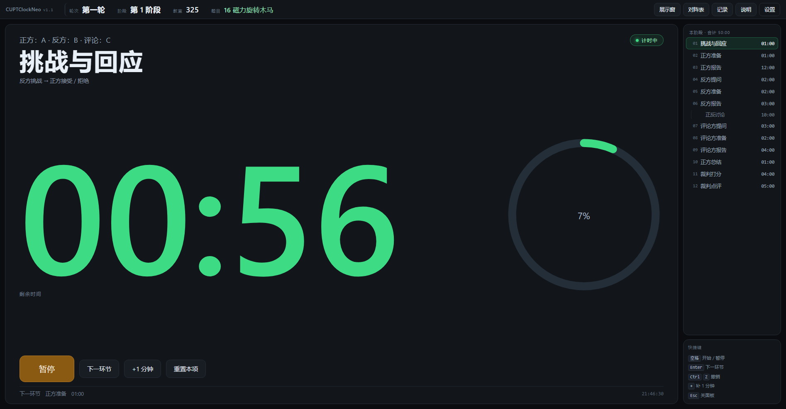
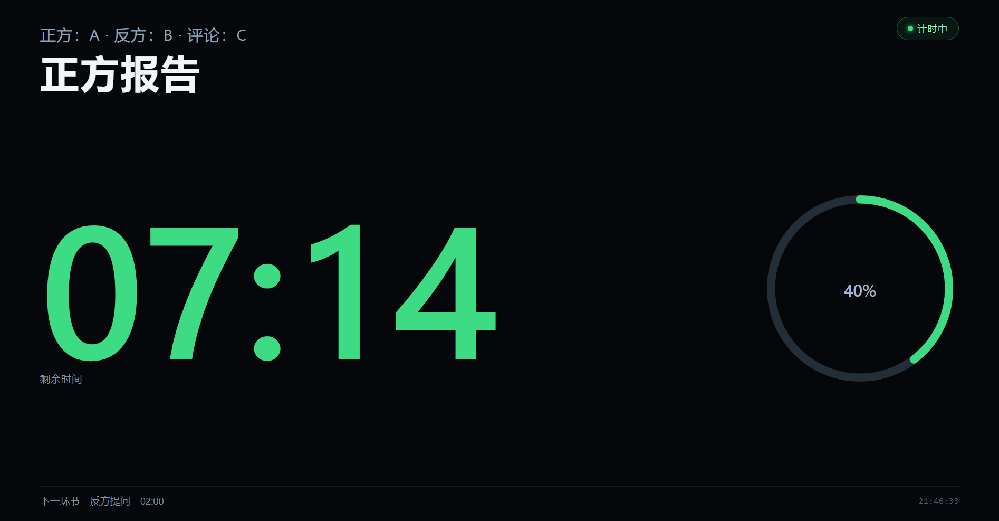
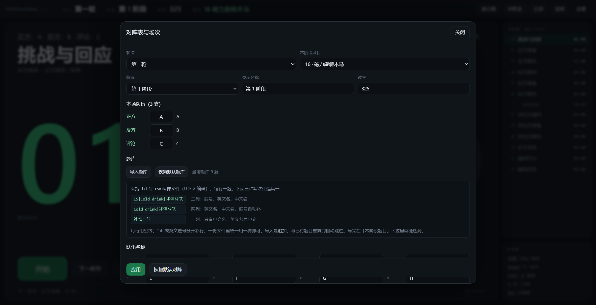
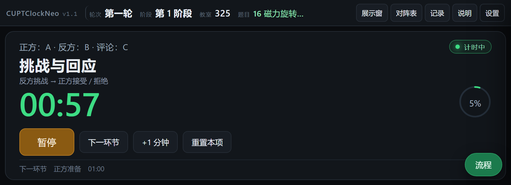

# CUPTClockNeo 2026

中山大学物理学社（Torchwood）2026 年 CUPT 校赛的赛场计时台。**单文件网页应用，零依赖、离线运行**，另附 Windows 与 macOS 桌面外壳。



## 这是什么

按 2026 年 CUPT 赛事手册的时间表计时：一个阶段 12 个可计时环节、合计 **50:00**。它解决的是赛场上的三个实际麻烦：

- **反方报告的时间要流进讨论**。手册里「反方报告 3 分钟」和「正反讨论 13 分钟」是同一个时段，程序把它做成一个容器：反方讲多久，讨论就少多久，不需要志愿者多按一次键。
- **选手和观众要同时看见**。控制台留给计时员，展示窗投到大屏，两个窗口不需要联网，关掉展示窗再点一次即可重连。
- **误触不能把表归零**。空格只管开始和暂停，结束必须是 Enter，每一步都能 Ctrl+Z 撤销。

## 三个平台

| 平台 | 获取方式 | 说明 |
| --- | --- | --- |
| Windows | 本仓库 **Releases** 里的压缩包 | 绿色版，解压双击即用，不写注册表 |
| macOS | 仓库内 `CUPTClockNeo2026-v1.1-macOS/` | 到 Mac 上双击 `双击打包.command`，自动下载运行时并生成 `.app` |
| 任意平台 | 直接打开 `CUPTClockNeo2026-v1.1.html` | 单文件，双击即用，可以单独拷进 U 盘 |

> Windows 版没有直接放进仓库：Electron 运行时有 238 MB 的单个可执行文件，超过 GitHub 100 MB 的单文件限制，因此放在 Releases 附件里。

## 主要特性

**计时**

- 12 个环节、合计 50:00，与手册表 2 一致（手册中「反方向正方挑战」与「正方接受或拒绝」各记 1 分钟，现场是连续动作，这里合并为 1 分钟）
- 反方报告满 3 分钟自动切进讨论，剩余时间始终等于 `13:00 − 已用`
- 剩余 20% 转黄、60 秒转红、超时闪烁并显示超时读数
- 每项可 +1 分钟、可重置、可撤销

**场次**

- 三支队伍（手册表 1a）与四支队伍（手册表 1b）两种分组，角色自动轮换，**计时流程不受影响**
- 轮次、阶段、教室、题目都可自定义；阶段可选第 1–4 阶段、决赛或自定义名称
- 题库内置 2026 年九道题，支持导入 `.txt` / `.csv`，每行一题，三种写法任选
- 每个「轮次 + 阶段 + 教室」各自记住选过的题目

**双窗与遥控**

- 控制台点「展示窗」另开一个窗口，拖到投影屏按 F11 全屏
- 展示窗可以用空格 / Enter / Ctrl+Z / `+` 直接操作，命令转发给控制台执行，左下角会闪一行「已发送：xxx」

**其他**

- 计时记录可导出 CSV（时间、场次、环节、计划、实际、超时）
- 响应式：电脑、平板横屏、手机横屏都能用；手机竖屏显示「请横屏使用」
- 数据存在浏览器 localStorage 里，清除浏览器数据会丢，换机器请重新填一次

## 快速开始

1. 打开 `CUPTClockNeo2026-v1.1.html`（或 Windows 版 exe）。
2. 点右上「对阵表」，选轮次 / 阶段 / 教室 / 题目，填队伍代号，点「应用」。
3. 点「展示窗」，把新窗口拖到投影屏并全屏。
4. 回控制台点「开始」（或按空格）。
5. 一个环节结束按「下一环节」（或 Enter），下一项自动开始。

完整操作、赛前检查清单、故障处理见 [使用说明.md](使用说明.md)。

## 一个阶段的时间分配

| # | 环节 | 时长 |
| --- | --- | --- |
| 1 | 挑战与回应 | 01:00 |
| 2 | 正方准备 | 01:00 |
| 3 | 正方报告 | 12:00 |
| 4 | 反方提问 | 02:00 |
| 5 | 反方准备 | 02:00 |
| 6 | 反方报告 + 正反讨论 | 03:00 / 13:00 |
| 7 | 评论方提问 | 03:00 |
| 8 | 评论方准备 | 02:00 |
| 9 | 评论方报告 | 04:00 |
| 10 | 正方总结 | 01:00 |
| 11 | 裁判打分 | 04:00 |
| 12 | 裁判点评 | 05:00 |
| | **合计** | **50:00** |

## 界面

展示窗（投到大屏的样子）：



对阵表面板（所有非计时操作都在这里）：



手机横屏（窄屏下右栏收进右下角「流程」浮钮）：



## 目录结构

```
cupt-clock-neo/
├── CUPTClockNeo2026-v1.1.html            单文件应用（三平台共用同一份）
├── 使用说明.md                            志愿者五分钟上手 + 故障处理
├── 赛程预设-2026.json                     时长与对阵表的可读存档
├── CUPTClockNeo2026-v1.1-macOS/          macOS 一键构建包
│   ├── 双击打包.command
│   ├── icon.icns
│   ├── 打包说明.md
│   └── app/                              程序本体（html + Electron 入口）
└── screenshots/
```

## 版本

当前 **v1.1.0**（2026-11-15）。变更记录见 [CHANGELOG.md](CHANGELOG.md)。

## 责任声明

本软件由中山大学 JONSIE 与人工智能协作开发，适用于 CUPT 框架内的校赛、模拟赛及队伍训练计时，**禁止任何形式的商业使用**，著作权及其他一切权利由开发者保留。软件按现状无偿提供，赛前请确认节次与规则一致，并保留人工计时作为备份。完整条款见 [使用说明.md](使用说明.md) 末尾。

反馈与意见：152050152@qq.com
